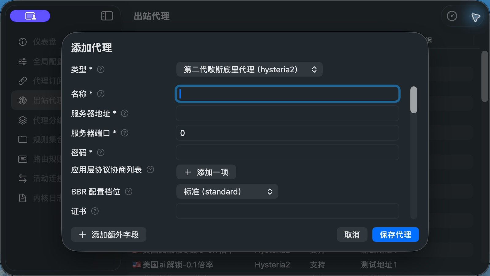
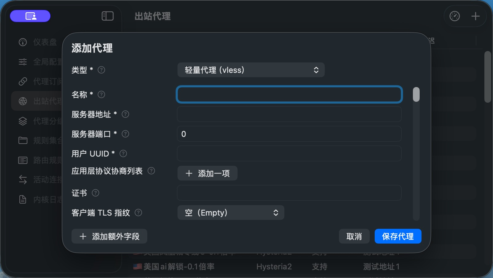
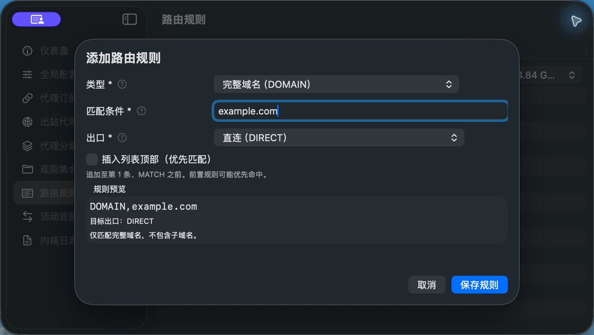
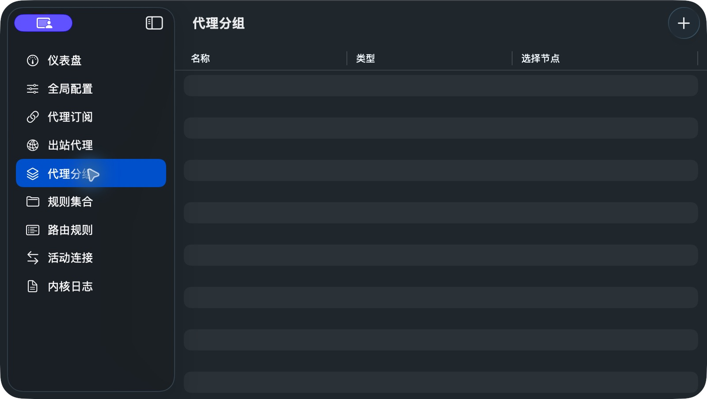
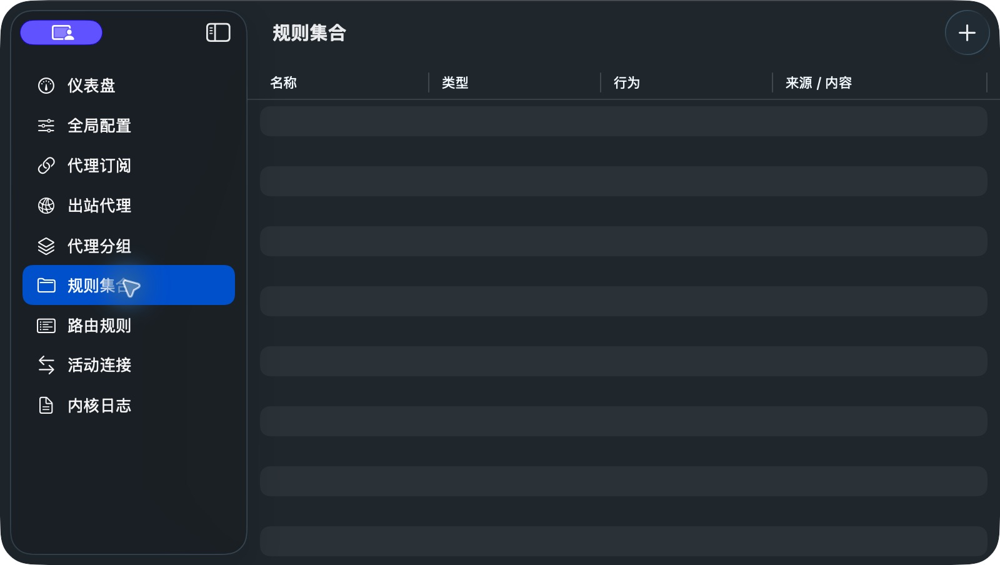
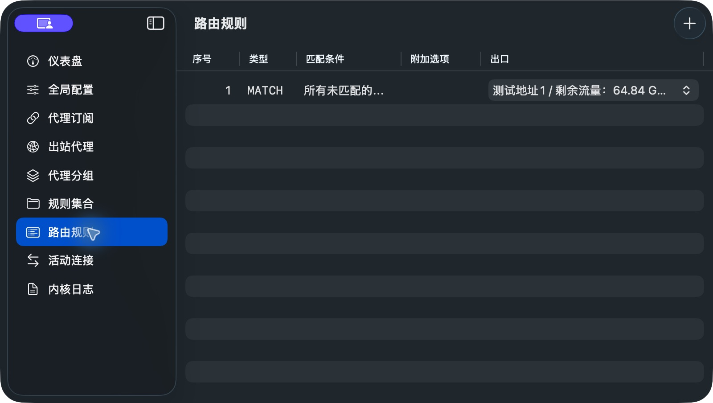
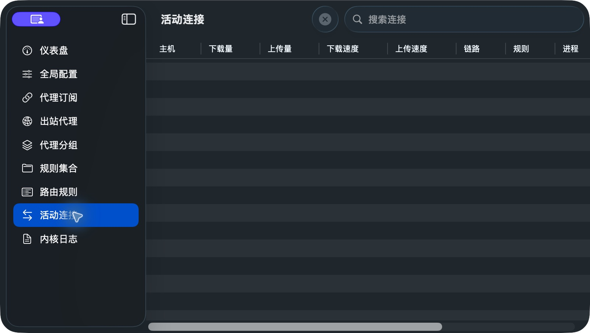

<div align="center">


# mihomo.GUI

一款使用 SwiftUI 构建的 macOS 原生 mihomo 客户端。

**订阅提供节点，网络策略由你掌控。**

[](#从源码运行与构建)
[](#安装)
[](#环境要求)

[项目初衷](#项目初衷) · [功能](#功能概览) · [预览](#界面预览) · [安装](#安装) · [构建](#从源码运行与构建) · [数据与隐私](#数据与隐私)

</div>

---

## 项目初衷

订阅更新应当更新节点，自己的 DNS、代理分组和分流规则则应由自己维护。Mihomo 将节点来源与网络策略分开管理，让更换订阅不必意味着重新整理整套配置。

通过原生界面编辑 mihomo 配置、查看字段说明与生成结果，减少日常维护 YAML 的负担，同时保留对具体参数的控制。草稿与已确认运行配置分别保存，启动前交由内核校验，让界面上的设置与实际运行行为有据可查。

代理服务独立于界面运行。关闭窗口或退出应用后，已启动的内核继续工作；重新打开应用即可连接现有服务，只有明确执行停止操作才会停止内核。

## 功能概览

- **全局配置**：编辑端口、DNS、嗅探和 TUN 等参数，自动保存，字段旁提供说明与上游文档链接。
- **代理订阅**：添加、编辑、更新和删除 mihomo YAML 订阅，查看流量与到期信息；仅导入节点。
- **出站代理**：管理手动节点与订阅节点，执行延迟测试，自定义测速地址与超时。
- **代理分组**：管理 `select`、`url-test`、`fallback`、`load-balance` 分组及有序成员。
- **规则集合**：管理 HTTP、本地文件和内嵌规则来源。
- **路由规则**：编辑匹配条件、出口与顺序，末尾保留 MATCH；支持从活动连接添加规则。
- **运行监控**：查看内核版本、内存、实时速率、累计流量、活动连接和配置预览，按需断开连接。
- **实时日志**：在日志页面查看内核日志，仅在页面打开时接收。
- **独立服务**：通过特权辅助服务管理内核，退出 GUI 后继续运行。

## 界面预览

默认展示全局配置与新建表单，每行三张，点击截图可查看原图。表单截图同时包含完整应用主窗口、侧栏和页面背景，保留默认尺寸与滚动方式，未填入真实凭据；路由规则使用 `example.com` 演示，未保存。

<table>
  <tr>
    <th>全局配置</th>
    <th>新建出站代理 · Hysteria2</th>
    <th>新建出站代理 · VLESS</th>
  </tr>
  <tr>
    <td width="33%"><a href="screenshots/general-configuration.jpg"></a></td>
    <td width="33%"><a href="screenshots/new-outbound-proxy.jpg"></a></td>
    <td width="33%"><a href="screenshots/new-outbound-vless.jpg"></a></td>
  </tr>
  <tr>
    <th>新建代理分组</th>
    <th>新建规则集合</th>
    <th>新建路由规则</th>
  </tr>
  <tr>
    <td width="33%"><a href="screenshots/new-proxy-group.jpg"></a></td>
    <td width="33%"><a href="screenshots/new-rule-provider.jpg"></a></td>
    <td width="33%"><a href="screenshots/new-route-rule.jpg"></a></td>
  </tr>
</table>

<details>
<summary>展开更多截图（全部主页面）</summary>

以下为其他主页面的完整窗口截图。内核未连接，代理分组与规则集合尚未添加，活动连接与日志为空。截图不展示订阅 URL、节点凭据或 API 密钥。

<table>
  <tr>
    <th>仪表盘</th>
    <th>代理订阅</th>
    <th>出站代理</th>
  </tr>
  <tr>
    <td width="33%"><a href="screenshots/dashboard.jpg"></a></td>
    <td width="33%"><a href="screenshots/subscriptions.jpg"></a></td>
    <td width="33%"><a href="screenshots/outbound-proxies.jpg"></a></td>
  </tr>
  <tr>
    <th>代理分组</th>
    <th>规则集合</th>
    <th>路由规则</th>
  </tr>
  <tr>
    <td width="33%"><a href="screenshots/proxy-groups.jpg"></a></td>
    <td width="33%"><a href="screenshots/rule-providers.jpg"></a></td>
    <td width="33%"><a href="screenshots/rules.jpg"></a></td>
  </tr>
  <tr>
    <th>活动连接</th>
    <th>内核日志</th>
  </tr>
  <tr>
    <td width="33%"><a href="screenshots/connections.jpg"></a></td>
    <td width="33%"><a href="screenshots/core-logs.jpg"></a></td>
  </tr>
</table>

</details>

## 安装

当前可按下文从源码构建，产物为 `dist/mihomo.app`。应用需要 macOS 13 或更高版本，构建时分别支持 Apple Silicon 与 Intel，单次构建生成当前机器架构的应用。

构建完成后可直接打开应用，也可将整个 `.app` 复制到“应用程序”目录。mihomo 内核与 GEO 数据随应用打包，无需另行指定内核路径。

> [!IMPORTANT]
> 当前构建使用本地临时签名，尚未采用正式签名、公证或 SMAppService。首次启动内核时，应用会通过系统管理员授权安装特权辅助服务。同一构建后续启停和保存运行配置通过 XPC 执行；更新构建后，首次操作可能需要重新授权。

## 使用说明与限制

### 首次使用

1. 在“全局配置”中按需设置端口、DNS、嗅探和 TUN。默认启用 DNS，使用 `fake-ip` 模式，默认关闭接受 IPv6 流量；已保存的用户设置优先。
2. 添加代理订阅或手动出站代理。订阅只导入节点，不导入其 DNS、代理组与路由规则。
3. 配置代理分组、规则集合和路由规则，确认末尾 MATCH 的出口。
4. 在“仪表盘”点击“启动 mihomo 内核”。应用校验配置，并在需要时请求管理员授权。
5. 通过仪表盘、活动连接与日志页面检查运行情况；需要停止服务时，在仪表盘明确点击“停止 mihomo 内核”。

### 配置与运行边界

- 运行期间，全局配置与规则集合只读；全局配置仍可上下滚动查看。节点、代理组与路由规则修改后自动应用。
- 全局配置中显示的已定义默认值和布尔开关会明确写入 YAML，界面、配置预览与运行配置使用同一份默认值；已编辑值优先。
- 未填写且没有默认值的可选字段继续省略，文档示例不会自动写入，其他平台专用字段不会自动补值。
- TUN 和代理监听端口需要用户自行开启和配置。应用提供控制接口与随机密钥以供 GUI 连接，已有配置保留。
- 订阅仅支持 mihomo YAML，不支持 Base64 / URI 转换；订阅由 GUI 更新，内核使用内联节点。
- 字段是否可用取决于打包的 mihomo 版本，复杂配置最终以内核校验结果为准。
- 真实 TUN 的 IPv6、其他 VPN 并存、休眠恢复与网络切换仍需实际环境验证。
- 退出应用不会停止内核，也不会卸载特权辅助服务。辅助服务权限绑定一个安装用户，其他用户使用时需重新授权。

## 从源码运行与构建

### 环境要求

- macOS 13 或更高版本。
- Xcode 或 Command Line Tools 提供的 Swift 编译器；`Package.swift` 声明 Swift tools 5.9。
- 当前机器架构对应的 macOS mihomo 内核，以及四份 GEO 数据。
- 系统 Ruby / Psych，用于订阅 YAML 解析；无需安装第三方 Swift 包。

### 获取源码与准备资源

```bash
git clone https://github.com/halifox/macos_clash.git mihomo
cd mihomo
```

按照 [内置资源说明](resources/README.md) 准备以下文件：

```text
resources/
  core/
    arm64/mihomo       # Apple Silicon 构建使用
    x86_64/mihomo      # Intel 构建使用
  geodata/
    Country.mmdb
    geoip.dat
    geosite.dat
    ASN.mmdb
```

只需准备当前构建机器对应架构的内核。内核必须是已解压的 macOS 可执行文件；构建脚本不会自动下载资源，缺少或为空时会报错。为两个架构分发时，分别在对应架构环境构建。

### 构建与运行

在仓库根目录执行：

```bash
bash scripts/build.sh
open dist/mihomo.app
```

脚本直接调用 `swiftc`，编译 GUI 与特权辅助程序，打包内核和 GEO 数据，然后进行本地临时签名。中间文件位于 `.build/manual/`，最终交付整个 `dist/mihomo.app`，无需另外交付 `resources/`。

重新构建后，请先用 Cmd-Q 退出旧应用，再打开新构建。也可通过 [Package.swift](Package.swift) 在支持 Swift Package 的开发环境中打开项目；完整编译、打包与签名仍使用上述脚本。

### 验证

完成构建后，可运行仓库现有的交互回归检查：

```bash
bash scripts/check-interactions.sh
```

脚本使用隔离配置和真实内核检查配置、规则、运行状态及重连等行为。TUN、系统授权和真实网络环境下的行为仍需相应的人工验证。

### 技术栈与代码组织

| 部分 | 实现 |
| --- | --- |
| 原生界面 | SwiftUI，最低 macOS 13 |
| 代理内核 | 随应用打包的 mihomo |
| 配置与接口 | Swift / Foundation、mihomo API |
| YAML 解析 | 系统 Ruby / Psych |
| 本地持久化 | JSON 设置、节点与订阅缓存 |
| 服务管理 | launchd、特权 XPC 辅助服务 |
| 构建 | Shell / swiftc，无第三方 Swift 包依赖 |

```text
Sources/
  Mihomo/           页面、共享状态、配置协调与服务管理
  MihomoCore/           配置类型、API、订阅解析及字段文档
  MihomoHelper/         特权 XPC 服务入口
scripts/
  build.sh             编译、打包与本地签名
  check-interactions.sh
resources/             构建所需的内核与 GEO 数据
```

沿用一个页面一个 Swift 文件的组织方式，页面专用表单与辅助逻辑留在页面文件中。`MihomoCore` 供 GUI 与特权辅助服务共用；`DocSchemas.swift` 保存字段定义，`HelpDocs.swift` 保存字段说明。

## 数据与隐私

### 本地数据

用户数据保存在 `~/Library/Application Support/Mihomo/`：

| 内容 | 文件或目录 |
| --- | --- |
| 草稿配置 | `settings.json` |
| 已确认运行配置 | `runtime.json` |
| 节点与订阅缓存 | `nodes.json`、`providers/` |
| GEO 缓存 | `geodata/` |

用户数据目录权限为 `700`，设置与密钥文件权限为 `600`。配置与缓存可能包含订阅地址、节点凭据和控制接口密钥，请勿直接公开整个数据目录。

草稿与已确认配置分开保存，重新打开 GUI 时使用已确认运行配置连接现有内核，避免尚未应用的编辑影响重连。

当前不安装流量统计后台，也不写入统计数据库。内核日志通过 API 实时查看，应用不再额外采集落盘。

### 系统服务

| 内容 | 位置 |
| --- | --- |
| 内核 LaunchDaemon | `/Library/LaunchDaemons/local.mihomo.core.plist` |
| 辅助服务 LaunchDaemon | `/Library/LaunchDaemons/local.mihomo.helper.plist` |
| 特权辅助程序 | `/Library/PrivilegedHelperTools/local.mihomo.helper` |
| 安装的内核 | `/Library/PrivilegedHelperTools/Mihomo/mihomo` |
| 系统运行配置 | `/Library/Application Support/Mihomo/` |

辅助服务只接受安装用户及当前应用签名的请求。关闭窗口、退出或重新打开 GUI 均不会停止或重启内核。

### 网络请求与诊断

更新订阅时，应用会访问用户配置的订阅地址；测速会通过内核访问设置的测速地址。内核还会按配置访问远程规则来源、DNS 服务及代理服务器，并处理用户的网络流量。

首次启动会准备配置需要的 GEO 数据，优先使用所选内核的配套数据、应用内置数据，否则下载；自定义 GEO 下载地址优先。应用通过 mihomo 控制接口获取运行状态、连接和日志。

日志、配置预览与连接信息可能包含域名、IP 地址或其他敏感信息。提交 Issue、分享截图或日志前，请先删除订阅链接、密钥、节点凭据与个人网络信息。

## 许可证与第三方资源

当前仓库未附带源代码许可证文件。

mihomo 内核、GEO 数据及其他第三方资源遵循各自的许可证与使用条件，不因随应用打包而改变。分发应用时，应保留所使用内核及数据要求的许可和归属说明，资源准备要求见 [resources/README.md](resources/README.md)。

## 参与贡献

欢迎提交问题、改进建议和 Pull Request。修改代码前，请阅读 [AGENTS.md](AGENTS.md) 中的工程规范。

反馈问题时，请提供构建版本或提交号、macOS 版本、机器架构、复现步骤和实际现象；涉及网络、TUN 或服务启停问题时，请补充相关配置与环境，并在分享前脱敏。

应用按全新安装使用 `Mihomo` 数据目录及 `local.mihomo.*` 服务标识，不迁移或清理旧版数据与后台服务。
