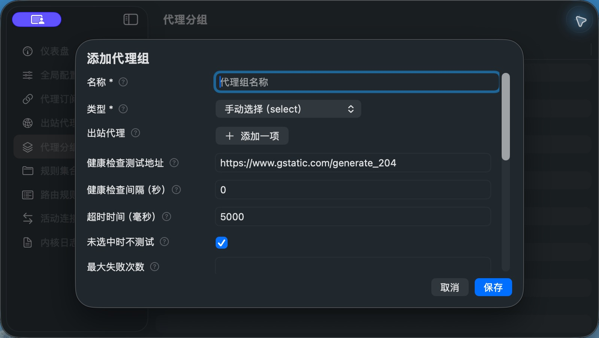
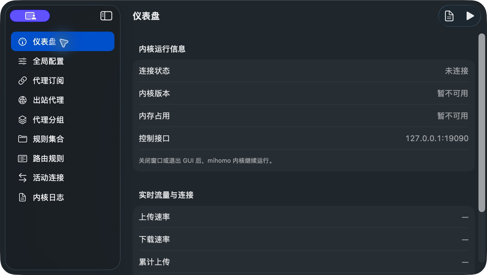
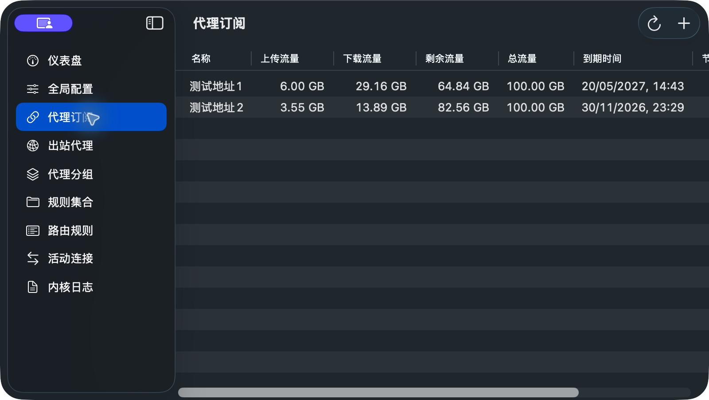
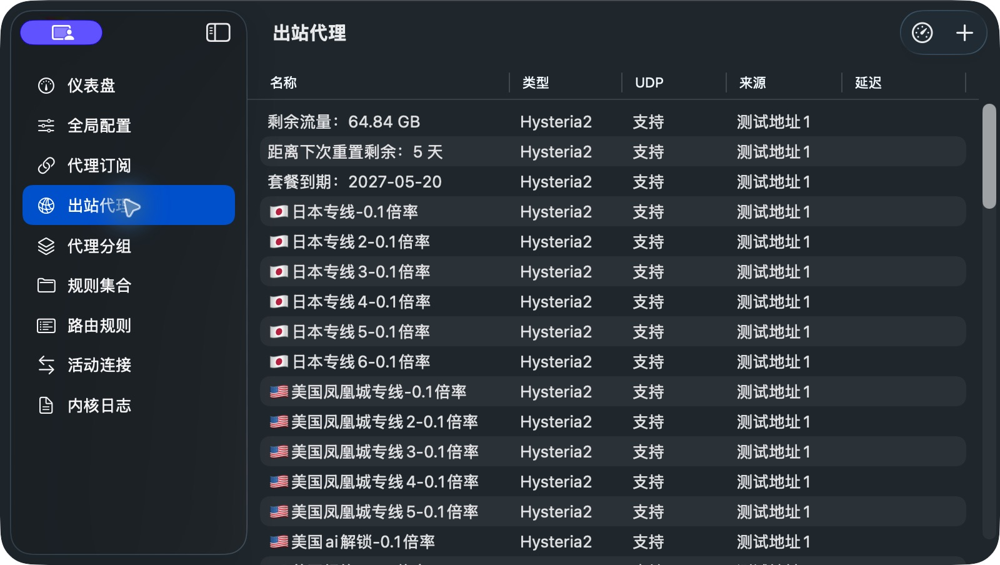

<div align="center">


# MihomoGUI

一款使用 SwiftUI 构建的 macOS 原生 mihomo 客户端。

订阅导入节点，本地维护网络策略。

[](#从源码运行与构建)
[](#安装)
[](#环境要求)

[项目初衷](#项目初衷) · [功能](#功能概览) · [预览](#界面预览) · [安装](#安装) · [构建](#从源码运行与构建) · [数据与隐私](#数据与隐私) · [许可证](#许可证与第三方资源)

</div>

---

## 项目初衷

MihomoGUI 将配置管理界面与代理服务分开运行。需要修改配置或查看连接时打开 GUI；关闭窗口或退出 GUI 后，已启动的 mihomo 内核继续由 launchd 管理。重新打开 GUI 会连接现有内核，无需重启代理服务。

订阅用于导入节点，DNS、TUN、代理分组和路由规则由用户单独维护。更换或更新订阅时，继续使用本地配置的网络策略。界面提供字段说明与配置预览，生成的配置最终由 mihomo 内核校验。

项目面向了解 Clash / mihomo 配置、希望自行维护网络策略的 macOS 用户。

## 功能概览

- **全局配置**：编辑端口、DNS、嗅探和 TUN 等参数，自动保存，字段旁提供说明与上游文档链接。
- **代理订阅**：通过 HTTPS 地址添加、编辑、更新和删除 mihomo YAML 订阅，查看流量、到期时间、节点数与上次更新时间；仅导入节点。
- **出站代理**：管理手动节点与订阅节点，执行单节点或全部节点延迟测试，支持取消测试、自定义测速地址与超时。
- **代理分组**：管理 `select`、`url-test`、`fallback`、`load-balance` 分组及有序成员，可直接在列表中切换 `select` 分组的出口。
- **规则集合**：管理 HTTP、本地文件和内嵌规则来源。
- **路由规则**：编辑匹配条件、出口与顺序，支持逻辑组合条件、重复检查与优先级提示，末尾保留 MATCH；支持从活动连接添加规则。
- **运行监控**：查看内核版本、内存、实时速率、累计流量、活动连接和当前设置生成的配置预览；查看或复制连接详情，关闭单条或全部连接。累计流量在内核重启后重置，不保存历史统计。
- **实时日志**：在日志页面查看内核日志，仅在页面打开时接收。
- **独立服务**：通过特权辅助服务管理内核，退出 GUI 后继续运行。

## 界面预览

<table>
  <tr>
    <th>全局配置</th>
    <th>新建出站代理 · Hysteria2</th>
    <th>新建出站代理 · VLESS</th>
  </tr>
  <tr>
    <td width="33%"><a href="screenshots/general-configuration.jpg"></a></td>
    <td width="33%"><a href="screenshots/new-outbound-proxy.jpg"></a></td>
    <td width="33%"><a href="screenshots/new-outbound-vless.jpg"></a></td>
  </tr>
  <tr>
    <th>新建代理分组</th>
    <th>新建规则集合</th>
    <th>新建路由规则</th>
  </tr>
  <tr>
    <td width="33%"><a href="screenshots/new-proxy-group.jpg"></a></td>
    <td width="33%"><a href="screenshots/new-rule-provider.jpg"></a></td>
    <td width="33%"><a href="screenshots/new-route-rule.jpg"></a></td>
  </tr>
</table>

<details>
<summary>展开更多截图（全部主页面）</summary>

<table>
  <tr>
    <th>仪表盘</th>
    <th>代理订阅</th>
    <th>出站代理</th>
  </tr>
  <tr>
    <td width="33%"><a href="screenshots/dashboard.jpg"></a></td>
    <td width="33%"><a href="screenshots/subscriptions.jpg"></a></td>
    <td width="33%"><a href="screenshots/outbound-proxies.jpg"></a></td>
  </tr>
  <tr>
    <th>代理分组</th>
    <th>规则集合</th>
    <th>路由规则</th>
  </tr>
  <tr>
    <td width="33%"><a href="screenshots/proxy-groups.jpg"></a></td>
    <td width="33%"><a href="screenshots/rule-providers.jpg"></a></td>
    <td width="33%"><a href="screenshots/rules.jpg"></a></td>
  </tr>
  <tr>
    <th>活动连接</th>
    <th>内核日志</th>
  </tr>
  <tr>
    <td width="33%"><a href="screenshots/connections.jpg"></a></td>
    <td width="33%"><a href="screenshots/core-logs.jpg"></a></td>
  </tr>
</table>

</details>

## 安装

### macOS

从 [GitHub Releases](https://github.com/halifox/mihomoGUI/releases) 下载 `MihomoGUI-v版本号-macos-arm64.zip`，解压后将 `MihomoGUI.app` 放入“应用程序”目录。自动发布包仅提供 Apple Silicon 版本。

当前 GitHub Actions 配置使用 Xcode 26.5 / macOS 26.5 SDK 构建，最低部署版本为 macOS 13。

- **Apple Silicon（M 系列芯片）**：选择 `arm64` 安装包。
- **Intel 芯片**：需要自行准备对应内核并从源码构建。

需要 macOS 13 或更高版本。应用已包含 mihomo 内核与 GEO 数据，无需另行下载。

首次启动内核时，按系统提示授予管理员权限。当前应用使用本地临时签名，尚未正式签名或公证；更新后首次启动内核可能需要重新授权。

## 使用说明与限制

### 首次使用

1. 在“全局配置”中按需设置端口、DNS、嗅探和 TUN。默认启用 DNS，使用 `fake-ip` 模式，默认关闭接受 IPv6 流量；已保存的用户设置优先。
2. 添加代理订阅或手动出站代理。订阅只导入节点，不导入其 DNS、代理组与路由规则。
3. 配置代理分组、规则集合和路由规则，确认末尾 MATCH 的出口。
4. 在“仪表盘”点击“启动 mihomo 内核”。应用校验配置，并在需要时请求管理员授权。
5. 通过仪表盘、活动连接与日志页面检查运行情况；需要停止服务时，在仪表盘明确点击“停止 mihomo 内核”。

### 配置与运行边界

- 内核服务运行或已加载时，全局配置只读；修改前需停止内核。订阅节点、手动节点、代理组、规则集合与路由规则修改后自动应用。
- 更新前会保存未完成标记；意外退出后，仪表盘会提示恢复，可重新应用当前设置或停止并重新启动内核。
- 自动应用失败会提示错误，已保存的本地修改不代表已生效；必要时停止并重新启动内核。仪表盘的配置预览根据当前设置生成，不能作为已应用成功的依据。
- 全局配置中显示的已定义默认值和布尔开关会明确写入 YAML，界面、配置预览与运行配置使用同一份默认值；已编辑值优先。
- 未填写且没有默认值的可选字段继续省略，文档示例不会自动写入，其他平台专用字段不会自动补值。
- TUN 和代理监听端口需要用户自行开启和配置。应用提供控制接口与随机密钥以供 GUI 连接，已有配置保留。非回环控制接口必须设置非空密钥；只有数字回环地址（127.0.0.0/8、::1）允许空密钥，主机名同样要求密钥。
- 订阅下载上限 16 MiB，GEO 下载上限 100 MiB；接收响应头及数据时均检查大小，没有 Content-Length 的响应也受限制。超限或取消会删除临时文件，HTTPS 下载拒绝降级重定向。
- 订阅地址必须是有效的 HTTPS URL，内容仅支持 mihomo YAML，不支持 Base64 / URI 转换；添加或编辑时先拉取成功再保存，新增、编辑及刷新订阅均可取消；进入最终原子保存阶段后会完成提交，此时取消按钮禁用。订阅由 GUI 更新，内核使用内联节点，没有定时更新订阅的后台任务。
- 代理组启用 `include-all-proxies` 时，`filter` 按节点原名匹配，生成配置再转换为内部唯一名称；`exclude-filter` 同样按原名匹配，并作用于手动指定的成员；`exclude-type` 使用内核协议名称（例如 `Shadowsocks`），用 `|` 分隔且不区分大小写。全部成员被排除时，界面显示实际 `empty-fallback`（未设置时为 `COMPATIBLE`）。名称筛选使用系统正则表达式，多个表达式用反引号分隔，不支持的表达式会报错。
- 字段是否可用取决于打包的 mihomo 版本，复杂配置最终以内核校验结果为准。
- 真实 TUN 的 IPv6、其他 VPN 并存、休眠恢复与网络切换仍需实际环境验证。
- 辅助服务权限绑定一个安装用户，其他用户使用时需重新授权。

## 更新与卸载

更新前退出旧 GUI，再替换应用并打开新版本。退出 GUI 不会停止已有内核服务；需要使用新版内核时，在界面中停止并重新启动内核，按系统提示完成授权。

仅删除 `.app` 不会移除系统服务或用户配置。完整移除步骤见 [卸载说明](docs/uninstall.md)。

## 从源码运行与构建

### 环境要求

- macOS 13 或更高版本。
- Xcode 或 Command Line Tools 提供的 Swift 编译器；`Package.swift` 声明 Swift tools 5.9。
- 当前机器架构对应的 macOS mihomo 内核，以及四份 GEO 数据。
- 系统 Ruby / Psych，用于订阅 YAML 解析；无需安装第三方 Swift 包。

### 获取源码与准备资源

```bash
git clone https://github.com/halifox/mihomoGUI.git MihomoGUI
cd MihomoGUI
```

Apple Silicon 环境可安装 GitHub CLI 并设置 `GH_TOKEN`，按仓库资源清单下载内核与 GEO 数据：

```bash
python3 scripts/resources.py download
```

此方式需要 Python 3，下载时校验清单中的 SHA-256。清单目前提供 arm64 内核；Intel 构建需另行准备 x86_64 内核。也可按照 [内置资源说明](resources/README.md) 手动准备以下文件：

```text
resources/
  core/
    arm64/mihomo       # Apple Silicon 构建使用
    x86_64/mihomo      # Intel 构建使用
  geodata/
    Country.mmdb
    geoip.dat
    geosite.dat
    ASN.mmdb
```

只需准备当前构建机器对应架构的内核。内核必须是已解压的 macOS 可执行文件；构建脚本不会自动下载资源，缺少或为空时会报错。为两个架构分发时，分别在对应架构环境构建。

### 构建与运行

在仓库根目录执行：

```bash
bash scripts/build.sh
open dist/MihomoGUI.app
```

脚本直接调用 `swiftc`，编译 GUI 与特权辅助程序，打包内核和 GEO 数据，复制第三方许可说明与资源清单，然后进行本地临时签名。中间文件位于 `.build/manual/`，最终交付整个 `dist/MihomoGUI.app`，无需另外交付 `resources/`。

重新构建后，请先用 Cmd-Q 退出旧应用，再打开新构建。也可通过 [Package.swift](Package.swift) 在支持 Swift Package 的开发环境中打开项目；完整编译、打包与签名仍使用上述脚本。

### 验证

完成构建后，可运行仓库现有的交互回归检查：

```bash
bash scripts/check-interactions.sh
```

脚本使用隔离配置和真实内核检查配置、规则、运行状态及重连等行为。TUN、系统授权和真实网络环境下的行为仍需相应的人工验证。

### 技术栈与代码组织

| 部分 | 实现 |
| --- | --- |
| 原生界面 | SwiftUI，最低 macOS 13 |
| 代理内核 | 随应用打包的 mihomo |
| 配置与接口 | Swift / Foundation、mihomo API |
| YAML 解析 | 系统 Ruby / Psych |
| 本地持久化 | JSON 设置、节点与订阅缓存 |
| 服务管理 | launchd、特权 XPC 辅助服务 |
| 构建 | Shell / swiftc，无第三方 Swift 包依赖 |

```text
Sources/
  MihomoGUI/               页面、共享状态、配置协调与服务管理
  MihomoGUICore/           配置类型、API、订阅解析及字段文档
  MihomoGUIHelper/         特权 XPC 服务入口
scripts/
  build.sh                 编译、打包与本地签名
  check-interactions.sh    交互与数据契约回归检查
  resources.py             按清单下载资源、更新资源清单
resources/                构建所需的内核与 GEO 数据
```

## 数据与隐私

### 本地数据

用户数据保存在 `~/Library/Application Support/MihomoGUI/`：

| 内容 | 文件或目录 |
| --- | --- |
| 草稿配置 | `settings.json` |
| 已确认运行配置 | `runtime.json` |
| 节点与订阅缓存 | `nodes.json`、`providers/` |
| GEO 缓存 | `geodata/` |

用户数据目录权限为 `700`，设置与密钥文件权限为 `600`。配置与缓存可能包含订阅地址、节点凭据和控制接口密钥，请勿直接公开整个数据目录。

草稿与已确认配置分开保存，重新打开 GUI 时使用已确认运行配置连接现有内核，避免尚未应用的编辑影响重连。

应用不保存历史流量统计。内核日志通过 API 实时查看，当前服务的标准输出和标准错误重定向到 `/dev/null`。启动失败时会显示安装/授权/launchd 加载等诊断类别；控制接口未就绪时补充 launchd 的退出码等数值状态。短时命令默认 45 秒、Ruby 解析 30 秒、辅助服务命令 120 秒、管理员授权和 XPC 请求 180 秒超时；子进程先请求终止，5 秒后仍未退出则强制结束所属进程组。特权操作超时不代表未执行，应先检查服务状态。辅助服务仅保留至多 16 KiB 的临时命令输出，并按允许的类别生成错误提示，不回传原始配置或内核日志。

### 系统服务

| 内容 | 位置 |
| --- | --- |
| 内核 LaunchDaemon | `/Library/LaunchDaemons/local.MihomoGUI.core.plist` |
| 辅助服务 LaunchDaemon | `/Library/LaunchDaemons/local.MihomoGUI.helper.plist` |
| 特权辅助程序 | `/Library/PrivilegedHelperTools/local.MihomoGUI.helper` |
| 安装的内核 | `/Library/PrivilegedHelperTools/MihomoGUI/mihomo` |
| 系统运行配置 | `/Library/Application Support/MihomoGUI/` |

辅助服务只接受安装用户及当前应用签名的请求。

### 网络请求与诊断

更新订阅时，应用会访问用户配置的订阅地址；测速会通过内核访问设置的测速地址。内核还会按配置访问远程规则来源、DNS 服务及代理服务器，并处理用户的网络流量。

启动内核时会准备配置需要的 GEO 数据，保留有效缓存，并从内置资源补充缺失数据，必要时下载；自定义 GEO 下载地址优先。应用固定使用内置内核。应用通过 mihomo 控制接口获取运行状态、连接和日志。

日志、配置预览与连接信息可能包含域名、IP 地址或其他敏感信息。提交 Issue、分享截图或日志前，请先删除订阅链接、密钥、节点凭据与个人网络信息。

## 许可证与第三方资源

本项目源代码采用 [GNU General Public License v3.0](LICENSE)（SPDX：`GPL-3.0-only`）。第三方资源按各自许可证分发。

[resources/licenses/](resources/licenses/) 保存了打包资源的许可文本与归属说明，构建时随资源清单一并复制到应用中。mihomo 内核、GEO 数据及其他第三方资源遵循各自的许可证与使用条件，不因随应用打包而改变。分发应用时，应保留所使用内核及数据要求的许可和归属说明，资源准备要求见 [resources/README.md](resources/README.md)。

## 参与贡献

欢迎提交 [Issue](https://github.com/halifox/mihomoGUI/issues) 和 Pull Request。开发约定、验证要求与提交格式见 [贡献指南](CONTRIBUTING.md)，自动构建与发布流程见 [发布维护文档](docs/releasing.md)。

反馈问题时，请提供应用版本或提交号、macOS 版本、机器架构、复现步骤和实际现象。涉及网络、TUN 或服务启停时，请补充相关环境与已脱敏配置；不要公开订阅地址、密钥或节点凭据。
